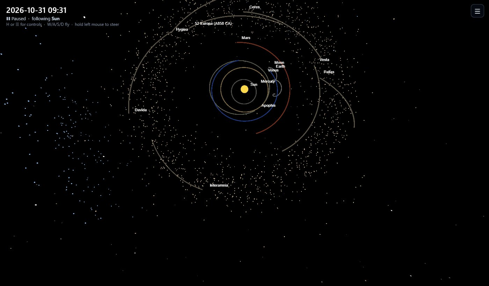
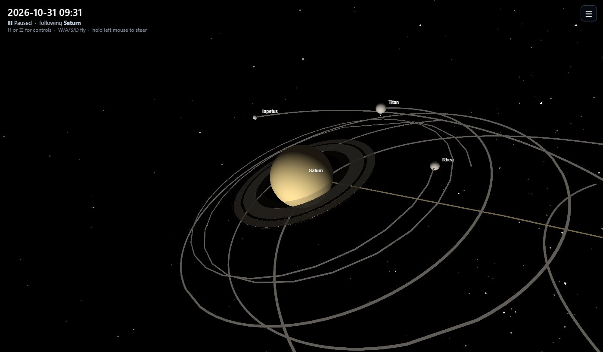
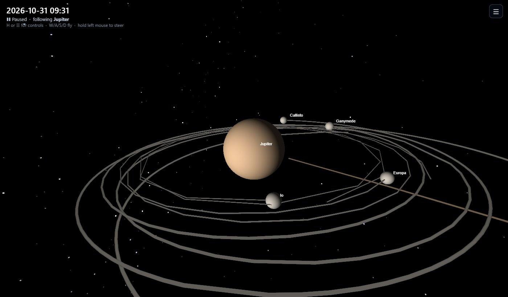
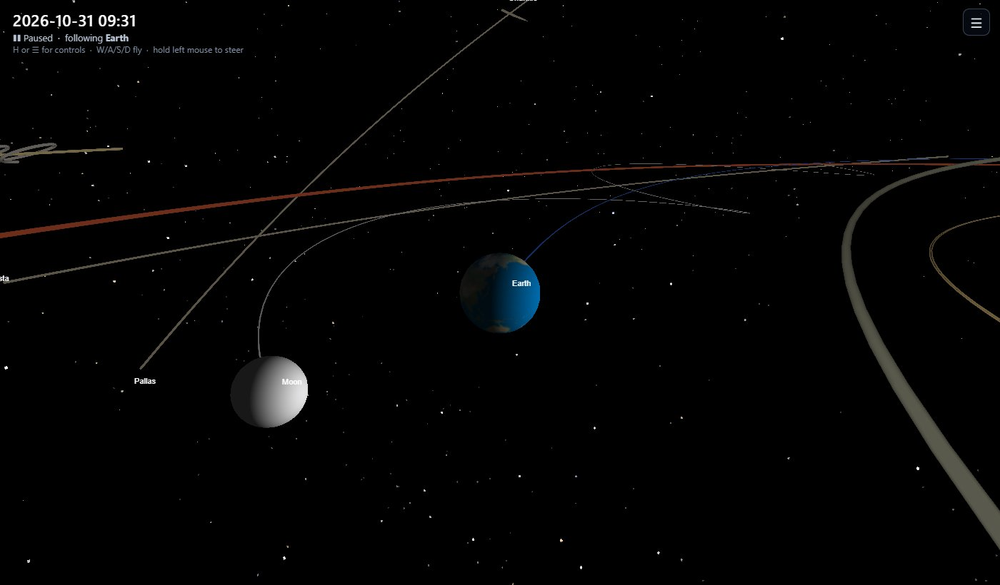
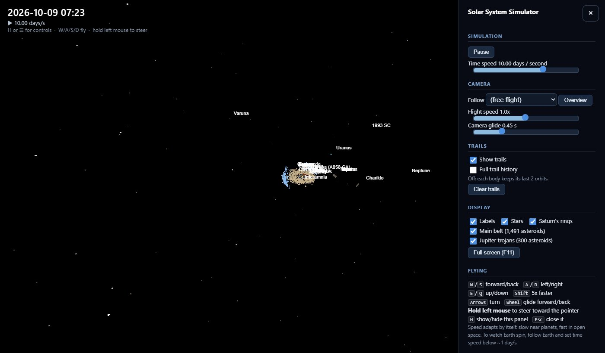
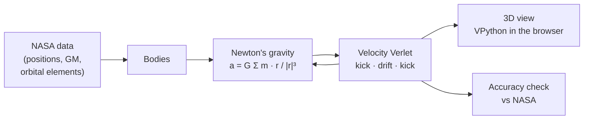
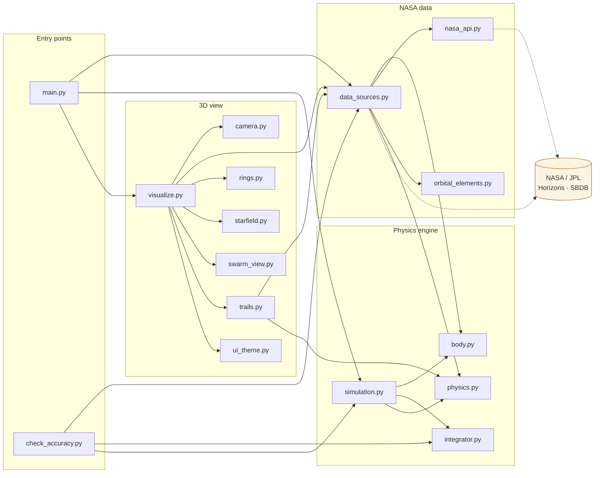

# 🪐 Solar System Simulator

**A real-data N-body simulation of the Solar System in Python, from NASA's measurements to a 3D view you can fly through.**

The planets, moons, asteroid belt and Saturn's rings all start from **NASA/JPL's measured positions** on a chosen date, move under
**Newton's gravity**, and are **checked against where NASA says they really were**. After a simulated year, Earth lands about
**50–110 km** from its real position, out of a ~940-million-km journey.



<!-- AUTO:STATS -->
**16 Python files · 3,242 lines**, most of them comments explaining the physics for beginners.
<!-- /AUTO:STATS -->

---

## ✨ What it does

| | |
|---|---|
| 🌍 **Real starting data** | Positions and velocities from NASA JPL **Horizons**; masses as NASA's precisely measured **GM** values |
| 🧮 **N-body physics** | Every body pulls every other; **velocity Verlet** (symplectic) integrator keeps energy steady for millions of steps |
| 🌙 **Moons** | Any of ~460 moons NASA tracks (Galilean moons, Titan…), with tidally locked spin from Kepler's laws |
| ☄️ **Asteroid belt & Trojans** | ~1,800 real asteroids converted from NASA orbital elements with **Kepler's equation**; Kirkwood gaps and Jupiter's L4/L5 Trojans emerge from the data |
| 🪐 **Saturn's rings** | NASA's measured ring radii, optical depth (see-through-ness) and real ring-plane orientation |
| 🧭 **Real spin axes** | Every planet's axis from NASA pole data; reproduces Saturn's 2025 ring-plane crossings to within 0.04° |
| 🚀 **Free-flying camera** | Spaceship-style controls with inertia, follow any body, smooth flights |
| ✅ **Self-checking** | `check_accuracy.py` measures energy conservation and compares against NASA |
| 📘 **A 40+ page guide** | [`docs/Solar_System_Simulator_Guide.pdf`](docs/Solar_System_Simulator_Guide.pdf) explains all the physics and code for beginners |

## 📸 Screenshots

| Saturn with its rings and moons | Jupiter and the Galilean moons |
|---|---|
|  |  |
| **Earth and the Moon** | **The control panel** (press <kbd>H</kbd>) |
|  |  |

## 🚀 Quick start

```powershell
py -3.13 -m venv .venv
.venv\Scripts\Activate.ps1          # macOS/Linux: source .venv/bin/activate
pip install -r requirements.txt
python main.py                      # opens the 3D view in your browser
python check_accuracy.py            # tests the physics against NASA (no graphics)
```

**Flying:** <kbd>W</kbd><kbd>A</kbd><kbd>S</kbd><kbd>D</kbd> thrust · <kbd>E</kbd>/<kbd>Q</kbd> up/down · arrows turn ·
hold the left mouse button to steer · mouse wheel to glide · <kbd>Shift</kbd> faster · <kbd>H</kbd> control panel.

## ⚙️ How it works

Every frame, the simulation steps forward with Newton's gravity, then the 3D view and camera catch up:



How the files depend on each other. This diagram is **generated from the code's `import` lines**:

<!-- AUTO:ARCHITECTURE -->

<!-- /AUTO:ARCHITECTURE -->

**Key ideas** (each explained in depth in the guide):

- **Symplectic integration.** Velocity Verlet's energy error stays bounded instead of drifting: ~1,000,000× better than forward Euler at the same cost.
- **GM, not kg.** Gravity only uses *G·M*, which NASA measures to ~11 digits; *G* alone is known to ~5. Storing kg cost 88,700 km of accuracy per year; GM fixed it.
- **Test particles and two clocks.** Asteroids feel gravity but don't pull (N×M instead of N² work, 144× faster), and move on a once-a-day "slow lane" while the moons need 25-minute steps.
- **Kepler's equation.** *M = E − e sin E*, solved by Newton's method, turns NASA's orbital elements into positions for thousands of asteroids at once.
- **Honest drawing.** Physics runs at true scale; only the picture is exaggerated (sizes, moon distances), and the guide says exactly how.

## ✅ Accuracy

Results of `check_accuracy.py`: start from NASA's real positions, simulate one year, then compare Earth's position with NASA's.

<!-- AUTO:VALIDATION -->
| Setup (start 2026-01-01, simulate 1 year) | Energy error | Earth vs NASA's real position |
|---|---:|---:|
| Sun + Earth, forward Euler | 9.33e-03 | **5,430,006 km** |
| Sun + Earth, velocity Verlet | 8.70e-09 | **1,159,713 km** |
| All 8 planets + Moon, velocity Verlet | 4.60e-09 | **109 km** |
| Same, 15-minute steps | 2.88e-10 | **50 km** |
<!-- /AUTO:VALIDATION -->

With only the Sun and Earth, real Earth is pulled by bodies the simulation doesn't contain. Adding them shrinks the error ~10,000×.
The last ~50 km is mostly **general relativity**, which a Newtonian model leaves out.

## 🛠️ Configuration

Everything you'd change lives at the top of [`main.py`](main.py): which planets, moons, asteroid swarms, the time step and the speed.
Current settings:

<!-- AUTO:SETTINGS -->
```python
# ============================== SETTINGS ===================================
START_DATE = "2026-01-01"   # real NASA positions on this date

# BODY_NAMES = ["Sun", "Earth"]
# BODY_NAMES = ["Sun", "Earth", "Moon"]
BODY_NAMES = ["Sun", "Mercury", "Venus", "Earth", "Moon", "Mars",
              "Jupiter", "Saturn", "Uranus", "Neptune"]

# Moons of other planets, fetched from NASA. For each planet, give:
#   a list of names  -> just those moons
#   "measured"       -> every moon whose mass JPL has measured (the big ones)
#   "all"            -> every moon NASA tracks (Saturn alone has ~290!)
# Try:  python -c "import nasa_api; print(nasa_api.list_moons('Saturn'))"
MOONS = {
    "Jupiter": ["Io", "Europa", "Ganymede", "Callisto"],   # the 4 Galilean moons
    "Saturn": ["Titan", "Rhea", "Iapetus"],
    # "Mars": ["Phobos", "Deimos"],  # WARNING: Phobos orbits in 7.7 h -> tiny dt -> slow
    # "Uranus": "measured",
    # "Neptune": ["Triton"],
}

# Asteroid/comet searches in JPL's Small-Body Database (see nasa_api.py).
SMALL_BODY_QUERIES = [
    {"kind": "asteroid", "limit": 10},                        # the 10 biggest asteroids
    # {"kind": "asteroid", "sb_class": "TJN", "limit": 20},    # Jupiter trojans
    # {"kind": "asteroid", "near_earth": True, "limit": 20},   # biggest near-Earth asteroids
    # {"kind": "comet", "limit": 5},                           # 5 biggest comets
]

# Hand-picked extras as (Horizons designation, display name).
SMALL_BODIES = [("99942", "Apophis")]

# Crowds of real asteroids, drawn as clouds of dots (see swarm_view.py).
# Orbits come from NASA in one request each; "count" = how many of the
# largest. Classes: IMB/MBA/OMB = inner/main/outer belt, TJN = Jupiter trojans.
# More dots = each dot is refreshed less often (swarm_view.py moves 150 dots
# per frame, so 1,800 dots are all refreshed 5 times a second).
SWARMS = [
    {"label": "Main belt", "sb_class": "IMB,MBA,OMB", "count": 1500},
    {"label": "Jupiter trojans", "sb_class": "TJN", "count": 300},
]
# SWARMS = []   # no belt

DT_HOURS = 1.0              # largest time step allowed. Made smaller automatically for fast moons
DAYS_PER_SECOND = 10.0      # starting animation speed (adjustable with the slider)
# ===========================================================================
```
<!-- /AUTO:SETTINGS -->

## 📁 Project structure

<!-- AUTO:MODULES -->
| File | What it does | Lines |
|---|---|---:|
| [`body.py`](body.py) | the one data type every object in the simulator shares. | 78 |
| [`camera.py`](camera.py) | a free-flying "spaceship" camera with inertia. | 316 |
| [`check_accuracy.py`](check_accuracy.py) | is the simulator right? Measure it, don't eyeball it. | 119 |
| [`data_sources.py`](data_sources.py) | real data from NASA, turned into Body objects. | 572 |
| [`integrator.py`](integrator.py) | moving time forward by one small step `dt`. | 69 |
| [`main.py`](main.py) | start the 3D Solar System. | 101 |
| [`nasa_api.py`](nasa_api.py) | one simple doorway to NASA/JPL data on moons, asteroids and comets. | 402 |
| [`orbital_elements.py`](orbital_elements.py) | from the six numbers that describe an orbit to a | 122 |
| [`physics.py`](physics.py) | Newtonian gravity for any number of bodies. | 170 |
| [`rings.py`](rings.py) | Saturn's rings, drawn from NASA's measured ring data. | 111 |
| [`simulation.py`](simulation.py) | holds all the bodies and runs time forward. | 180 |
| [`starfield.py`](starfield.py) | a background of distant stars (and a faint Milky Way band). | 92 |
| [`swarm_view.py`](swarm_view.py) | draws crowds of thousands of asteroids (the asteroid belt, | 149 |
| [`trails.py`](trails.py) | orbit trails that show about the last TWO orbits of each body, | 140 |
| [`ui_theme.py`](ui_theme.py) | restyles VPython's web page: full-window 3D view, a slide-out | 199 |
| [`visualize.py`](visualize.py) | the 3D view, drawn with VPython (opens in a browser tab). | 422 |
<!-- /AUTO:MODULES -->

## 🔄 This README updates itself

The blocks above marked as generated (statistics, architecture diagram, file table, settings, accuracy table) are rebuilt from the code by
[`docs/build_readme.py`](docs/build_readme.py):

- **On every push to GitHub**, a [GitHub Action](.github/workflows/readme.yml) regenerates them and commits the result if anything changed.
- **Locally:** `python docs/build_readme.py`. Add `--validate` to re-run the accuracy tests, `--screenshots` to retake the screenshots
  (needs `pip install playwright` and Edge or Chrome).

## 📚 Data sources & credits

- **NASA / JPL Solar System Dynamics:** [Horizons](https://ssd.jpl.nasa.gov/horizons/) (positions), [Small-Body Database](https://ssd-api.jpl.nasa.gov/doc/sbdb_query.html) (asteroids),
  [Planetary Satellite Physical Parameters](https://ssd.jpl.nasa.gov/sats/phys_par/) (moons), DE440 GM values.
- **NASA NSSDCA fact sheets:** planetary physical data, pole directions and [Saturn's rings](https://nssdc.gsfc.nasa.gov/planetary/factsheet/satringfact.html).
- **Book:** *Moving Planets Around: An Introduction to N-Body Simulations Applied to Exoplanetary Systems* by J. Roa, A. S. Hamers, M. X. Cai
  and N. W. C. Leigh (MIT Press, 2020, open access), the course this project follows.
- **3D graphics:** [VPython](https://vpython.org/).
